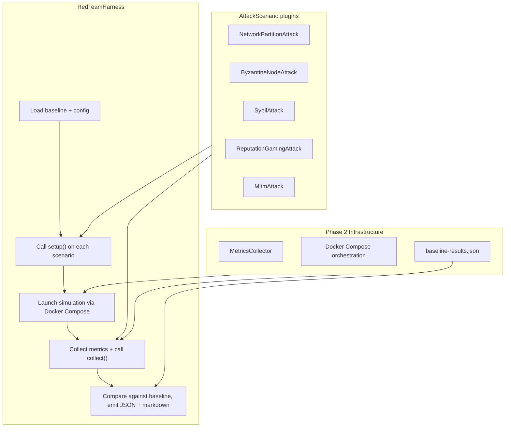
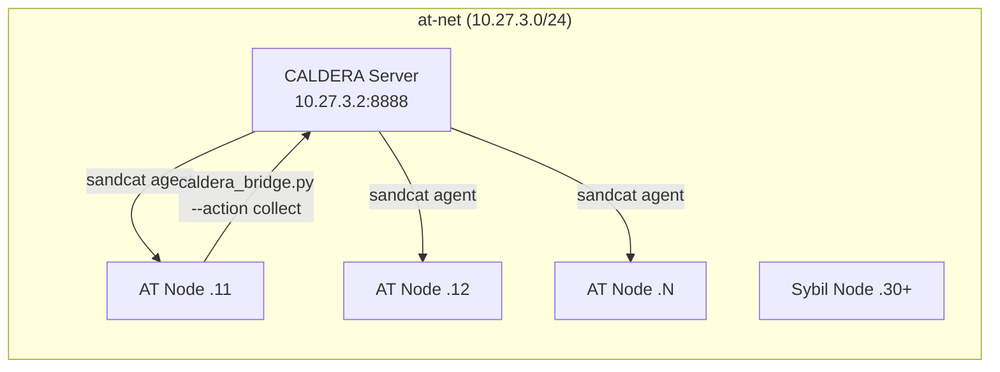

*Previous: [Integration testing](integration-testing.md)*

# Adversarial testing

The adversarial testing framework validates the security claims of the
AutonomousTrust protocol stack through five automated attack scenarios. Each
scenario targets a specific vulnerability class (Sybil resistance, Byzantine
fault tolerance, network partition recovery, reputation gaming resilience, and
encryption integrity) and measures the response against a Phase 2 baseline
collected from the Appalachian mesh simulation.

The framework is structured in two layers: a standalone Python layer that
requires no external dependencies, and an optional CALDERA orchestration layer
that adds MITRE ATT&CK-aligned scheduling and reporting.

## Architecture

The red team package (`simulator/redteam/`) provides a plugin interface, a
modified router for partition injection, and a harness that orchestrates the
full attack cycle.

## AttackScenario interface

Each attack implements the `AttackScenario` base class with three methods:

- **setup(sim_config, compose_config)** modifies simulation and Docker Compose configuration before containers launch. This is where routers are swapped, processes are replaced, and sidecar containers are injected.
- **teardown()** cleans up after the simulation ends or on failure. Called in a `finally` block by the harness.
- **collect(metrics)** adds attack-specific measurements to the metrics report after the simulation completes.

The original design considered a per-timestep `execute()` callback, but none of
the five attacks require runtime intervention. The AttackRouter handles
partition timing internally, and the remaining attacks are fully configured at
setup time.

## AttackRouter

`AttackRouter` extends the base `Router` from the radio layer. The parent router
manages iptables rules each timestep based on the terrain connectivity matrix.
AttackRouter calls `super().recv_data()` first to apply normal connectivity,
then re-injects DROP rules for any active partitions. This ordering ensures
partition isolation overrides connectivity even when the parent has just allowed
a link.

Partitions are defined as `PartitionEvent` dataclasses specifying a time window
and two groups of peer IDs. The router checks the partition schedule on each
timestep and activates or deactivates iptables DROP rules bidirectionally
between the groups. The `finish()` override clears all partition rules before
parent teardown.

## Attack scenarios

| Scenario | Mechanism | Target Vulnerability | Expected AT Response |
|----------|-----------|---------------------|---------------------|
| **Network Partition** | AttackRouter injects iptables DROP rules between peer groups on a timed schedule | No explicit partition recovery in the protocol | Store-and-forward recovery; state re-converges after partition heals |
| **Byzantine Node** | One member runs `EquivocatingReputationProcess`, which proposes each half as a separate `transaction` to every roster member, alternating the score 300 above and below the truth | A commit quorum at a simple majority rather than `> 2n/3` | No equivocated half gathers a quorum on one score; the honest chains stay one chain; honest pairs keep tier 3 |
| **Sybil** | Three or six fresh identities join two minutes after the honest cohort, inflate each other and slander every honest node, and answer probes correctly | Admission accepts every fresh keypair | Sybils are admitted (reported, not gated); no honest pair falls below tier 3; no Sybil rises above the told-tier ceiling without this node's own evidence |
| **Reputation Gaming** | A gamer answers every known-answer probe correctly for eight minutes, then wrongly; a second arm sets a 300 s minimum tenure on the honest nodes | Trust accumulated before the defection | Every honest node drops the gamer below tier 1 on its own evidence and keeps it there |
| **MITM** | A sidecar in one node's network namespace captures its UDP frames for ten minutes, classifies them, and replays everything it sent one peer point-to-point, from its own address | Encryption must hide content; per-verb sequence numbers must refuse replays | Only the verbs AT sends unencrypted by design appear in plaintext; the replay moves nothing |

The Byzantine attack exploits the Paxos quorum threshold. Since 2026-10-13
both phases need a simple majority of the group, the proposer counted
(`(len(peers) + 1) // 2` of the others), and each node accepts at most one half
per chain slot (doc/architecture/reputation.md, "Agreeing on a history"). A
majority does not meet the `> 2*peers/3` threshold required for Byzantine
fault tolerance: a single Byzantine node in a group of three is one of the two
votes any round needs, and can accept two rivals for one slot where an honest
node accepts one.

## Live runs

The Sybil, Byzantine, gaming and MITM attacks run against real nodes, the
same way the colluding-cohort evaluation does (`redteam/colluding_cohort.py`,
`doc/architecture/hostile-join.md`). Each attack's `setup` hands the harness a
whole compose deployment and marks it `standalone`; the harness brings it up,
waits out the run, reads the logs of the containers the scenario names, and
brings it down (`RedTeamHarness._run_standalone`). Every container runs a
Python node whose entry point is the attack's own module, and that module
prepares the node's configuration in the container before it starts the node:
a fresh identity carrying the container's address, the plaintext verbs of
every enabled extension, and, for an attacker, its process class swapped in
`subsystems.cfg.json` or its probe answers swapped in
`bootstrap_capabilities.BOOTSTRAP_FUNCTIONS`. `redteam/live.py` holds what the
attacks share. `scripts/test-redteam.sh` runs every arm with six honest nodes
for twenty minutes, three times, and writes each report and every container's
log to `.scale-results/redteam-<arm>/<repeat>/`.

The honest nodes run the join policy with no anchors, so each one probes
every peer it meets and earns its tiers on its own evidence. A baseline run
without it (six honest nodes, ten minutes) left every node with one or two
entries of its own per peer and no pair at tier 3; with it, every pair was at
tier 3 or above within 120 to 180 seconds and all six chains agreed. Each
honest node logs its reputation view every five seconds (`AT_REP_DUMP_SEC`),
and the attacks read their results from those `AT_REPDUMP` lines. A tier
counts only once the node holds evidence of its own about that peer, and a
time counts only if the condition held to the last dump. A run in which any
node the verdict rests on never dumped is `NO_DATA`, with the tail of its log
in the report.

**Sybil** (`sybil_attack.py`). The Sybils run `SybilReputationProcess`, the
colluding cohort's inflate-and-slander process with `sybil-` as the mark of a
fellow. Admission has no Sybil brake (it checks the build, key reuse and the
identity's validity, not how many identities one operator holds), so the
attack reports how many members the honest nodes hand the group key to and
how many Sybils each holds as peers, and gates on influence instead. It FAILs
when an honest node ends without holding every other honest node at tier 3,
or gives a Sybil a tier above the told-tier ceiling (`told_tier`, 1) while it
holds no evidence of its own about it.

**Byzantine** (`byzantine_node.py`). The equivocator builds each half with the
honest `_propose_half` and changes only the score per recipient. An acceptor
signs the exact (peer, task, score, channel) it was shown, so the signatures
an equivocated half gathers are over different scores. To see whether the
honest chains split, the dump carries `chain`: the primary chain's placed
length and the first 16 hex digits of its head entry's hash. The attack FAILs
when honest chain lengths end more than two entries apart, when two honest
nodes at one length hold different heads, or when an honest pair ends below
tier 3. It reports the equivocator's commits seen by honest nodes and any
`equivocation recorded on chain` errors from placement without gating on
them.

**Reputation gaming** (`reputation_gaming.py`). The gamer's probe answers are
module-level functions that read the defection time from
`AT_REDTEAM_DEFECT_AT`, so they survive the process pool's pickling. The
attack reads, per honest node, when the gamer first sat at tier 3, its
highest tier before the defection, its final tier, and how long after the
defection it fell below tier 1 for good. It FAILs when any honest node never
drops it below tier 1, or when an honest pair ends below tier 3.

**MITM** (`mitm_attack.py`, `mitm_sidecar.py`). The sidecar runs as root with
`NET_RAW` in `honest-1`'s network namespace, from the nodes' own image, and
needs nothing beyond the standard library: an `AF_PACKET` socket to capture,
and a UDP socket bound to `honest-1`'s address to replay. A captured payload
counts as plaintext only if it parses as an envelope: a JSON object with
`process` and `function`, or the protobuf marker `0xAB` followed by a
`NetMessage` with both set. Ciphertext is uniform bytes and may start with
either, so a payload that does not parse is opaque. Any plaintext verb
outside the core's `CORE_UNENCRYPTED_VERBS` and the extensions' declared
plaintext verbs FAILs. The replay FAILs when `honest-2`'s count of committed
transactions with `honest-1` rises, in the minute after the replay, by more
than five beyond the most it rose for any other honest peer. The other peers
are the control because a young cohort's first placements move every count at
once. The attack reports `honest-2`'s `not above mark` refusals, in all and
after the replay; a run whose sidecar replayed nothing is `NO_DATA`.

### Results, 2026-11-10

Six arms, three repeats each, six honest nodes, twenty minutes, Python
backend (`.scale-results/redteam-<arm>/1..3/`). No run was `NO_DATA`. Times
are seconds from a node's first dump, given as range and median over every
honest node of every repeat.

| Arm | Result | What the runs showed |
|---|---|---|
| sybil-k3 | 3 PASS | Honest pairs held at tier 3 from 120..241 s (median 180). All 3 Sybils admitted (8 members keyed). No Sybil above tier 1 without own evidence. |
| sybil-k6 | 3 PASS | Honest pairs held from 120..182 s (median 120). All 6 Sybils admitted (10..11 members keyed). No Sybil tier without own evidence. |
| byzantine | 3 PASS | Honest chains identical at the end (121, 116, 141 entries). Each honest node held the equivocator as a peer; none holds a commit with it. The equivocator logged 1,260..1,332 acceptances refused for want of a valid commit signature. Placement logged no equivocation. |
| gaming-tenure0 | 3 FAIL | The gamer reached tier 3 at 120..244 s (median 181) and tier 4 on most nodes. Twelve minutes after it defected it still sat at tier 2..3 on every honest node. |
| gaming-tenure1 | 3 FAIL | The 300 s tenure held the gamer's rise to 360..361 s (median 361). The fall is as slow as without tenure. |
| mitm | 3 PASS | 9,694..11,742 frames captured (median 10,346), 99.3..99.6% opaque. Plaintext was only `request_access` and `access_granted`. 484..540 frames replayed (median 516); `honest-2` refused 3..6 after the replay and committed nothing extra with `honest-1`. |

What the runs say about AT:

- **A Sybil that does honest work is a full member.** Admission let in every
  Sybil, and the Sybils earned their tiers on the honest nodes' own evidence
  by answering probes correctly: tier 4 on every honest node with six of
  them, and up to tier 4 with three. Their slander moved no honest pair: the
  influence gate held, and it holds because honest nodes weigh their own
  evidence, not because Sybils were kept out.
- **Equivocation dies at the acceptor.** No equivocated half gathered a
  quorum on one score, so nothing reached a chain and placement had nothing
  to record. The equivocator's own log is where it shows.
- **Defection by probe answers alone is slow to cost trust.** After the
  defection the gamer kept cooperating in transactions (no defections
  recorded, cooperations still rising), and only the wrong probe answers
  counted against it. Its score fell from 0.9 to 0.61..0.77 (median 0.72) by
  the end of the run, twelve minutes later, which is still tier 2 or 3. The minimum tenure delays the rise
  but does nothing for the fall.
- **The replay is refused.** Replayed point-to-point frames from `honest-1`
  moved none of `honest-2`'s counts beyond the control peers.

### Results, 2026-11-11: gaming against the probe hold

A failed known-answer probe is now held against the peer that failed it.
Under the join policy, two of our probe verdicts in a row below 0.5 hold its
brought score at 0.49, under tier 1, whatever its transactions say
(`probe_hold_of`, `reputation_probe_hold`). A single failure, or a 0.5 (an
out-of-tolerance time attestation, which a wrong clock and plain drift both
give), makes the peer a suspect that the bootstrap worker probes again at
once, up to three times, rather than waiting its turn in the steady probing.
A 0.5 neither joins a run of failures nor breaks one. Without that, a re-probe
that happened to ask the gamer for the time ended the suspicion, which is how
the first rerun lost most of its nodes.

Both gaming arms, same deployment as above, three repeats each, run twice on
the same code (`.scale-results/redteam-gaming-tenure{0,1}-probehold-v3/1..3/`,
then `-probehold-v4/1..3/`, which also logs the peer each probe went to):

| Arm | Run | Result | Honest nodes that dropped the gamer below tier 1 | `t_fall`, s after the defection |
|---|---|---|---|---|
| gaming-tenure0 | first | 3 PASS | 18 / 18 | 62..364 (median 184) |
| gaming-tenure1 | first | 2 PASS, 1 FAIL | 16 / 18 | 58..425 (median 186) |
| gaming-tenure0 | second | 2 PASS, 1 FAIL | 16 / 18 | 59..545 (median 181) |
| gaming-tenure1 | second | 1 PASS, 2 FAIL | 14 / 18 | 123..664 (median 216) |
| gaming-tenure0 | staleness bound | 3 PASS | 18 / 18 | 61..362 (median 241) |
| gaming-tenure1 | staleness bound | 3 PASS | 18 / 18 | 59..363 (median 212) |

Every honest node that probed the gamer after it defected dropped it to
tier 0 and kept it there, and every one that did not drop it never probed it:
in the second run that is 30 and 6 of 36, read from the probe log. Each of the
six sent twelve probes in the twelve minutes after the defection, all to
honest peers. Steady probing picks the peer probed least over the node's whole
life, deterministically, and the gamer had been probed more than any honest
peer while it behaved, so it waited at the back of the line until the run
ended. A staleness bound closed it: a peer left unprobed longer than one round
and one interval (seven minutes for six peers at 60 s) now goes to the front of
the line. Rerun on it (`.scale-results/redteam-gaming-tenure{0,1}/1..3/`), every
honest node probed the gamer after it defected, the latest 319 s after, and
every one dropped it. A gamer that alternates right and wrong answers
would also break every run of two; scoring the probe channel apart from the
rest would close that, and is not built.

## Harness orchestration

The harness accepts a list of `AttackScenario` instances and a base Appalachian
scenario configuration. It loads the Phase 2 baseline from
`baseline-results.json`, calls `setup()` on each scenario to modify the
configuration, launches the simulation, collects metrics, calls `collect()` for
attack-specific results, and compares post-attack metrics against the baseline.
Output is a consolidated JSON report with per-attack results (`PASS`, `FAIL`,
`ERROR`, or `NO_DATA`) and a human-readable markdown summary.

A configurable wall-clock timeout (default: `--quick` duration plus 60 seconds
grace) guards against hangs. If the simulation exits non-zero, the harness
collects partial metrics and marks the attack as `ERROR`. If metrics collection
fails entirely, container logs are attached under `NO_DATA`.

## CALDERA orchestration (optional)

MITRE CALDERA provides an optional scheduling and reporting layer. When enabled
via the `--caldera` flag, it runs alongside the AT containers on the same Docker
bridge network without replacing any attack logic.

The key design constraint is that `AttackScenario.setup()` methods modify
compose and simulation configuration **before** containers launch, while CALDERA
abilities run **after** containers are up. Therefore all attack
pre-configuration is baked into the Docker Compose YAML at generation time by
`caldera_compose.patch_caldera()`. CALDERA abilities only invoke `collect()`:
they gather attack-specific metrics from running containers via a CLI bridge
(`caldera_bridge.py`). The bridge is a thin read-only dispatcher: it
instantiates the appropriate `AttackScenario`, calls `collect()`, and prints
JSON to stdout.

Only three attacks are CALDERA-orchestrated (Sybil, Byzantine, reputation
gaming). The network partition attack operates at the Router level with no agent
needed, and the MITM attack uses its own capture sidecar.

CALDERA failures are non-fatal. If sandcat agents do not register within 60
seconds or if an operation fails, the harness falls back to direct Python
`collect()` calls with a warning. Metrics output is identical regardless of
whether CALDERA is active.

### IP allocation

| Address | Role |
|---------|------|
| `10.27.3.1` | Router gateway |
| `10.27.3.2` | CALDERA server (reserved) |
| `10.27.3.11+` | AT peer nodes |
| `10.27.3.30+` | Sybil attack nodes |

## Known vulnerabilities targeted

The adversarial framework specifically targets three weaknesses in the current
AT implementation:

1. **Insufficient Paxos quorum thresholds.** Both the prepare and accept phases use simple majority voting rather than the `> 2n/3` supermajority required for Byzantine fault tolerance. The Byzantine attack scenario validates whether AT can still detect and penalize inconsistent behavior despite this gap.

2. **Equivocation at the half.** A proposer can tell each acceptor a different score for one half. Proposals must arrive verified (`handle_transaction` drops an unverified one), and each acceptor signs the exact score it was shown, so the equivocator cannot assemble a commit certificate over any one score from signatures given to different ones. The Byzantine attack measures whether that holds live and whether the honest chains stay one chain.

3. **No explicit network partition recovery.** The protocol relies on store-and-forward semantics and history synchronization to recover from splits, but has no dedicated partition detection or recovery mechanism. The partition attack measures whether implicit recovery is sufficient.

---

*Next: [A compromise, detected](sg2-detection-walkthrough.md)*
