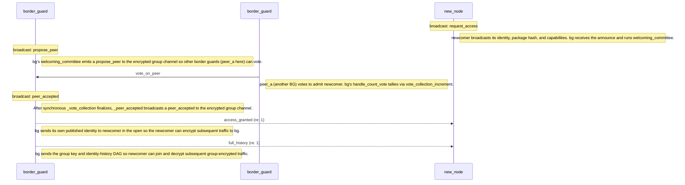

*Previous: [How a node is built](overview.md)*

# Becoming a peer

A node arriving on the network knows nothing and is owed nothing. It has a key
pair it generated itself, a list of what it can do, and no relationship with
anybody. Getting from there to being a member of a working group is the job of
the identity protocol, and it is the one place in the framework where a
permissionless population has to reach a decision.

The difficulty is the one every open network has. Anybody can generate a key
pair, so anybody can generate ten thousand of them, and a protocol that admits
whoever asks admits the ten thousand along with the one honest newcomer. That is
the Sybil attack, and there is no cryptographic answer to it, because every one
of the ten thousand identities is cryptographically impeccable.

Our answer is that admission is not a fact about the newcomer at all but a
decision made by the peers who are already in, by vote, on the encrypted channel
the newcomer cannot yet read. A newcomer announces itself in the open, existing
members propose it, existing members vote, and only a majority admits it. The
cost of manufacturing a thousand identities is unchanged, and the value of doing
so drops to nothing, because a thousand strangers still get zero votes.

What follows walks that process from the announcement through to full
membership, then covers what a member does afterward, what travels on which
channel, and what the protocol checks along the way.

## The channels

Three channels exist, and knowing which is which explains most of the protocol.

The *open broadcast channel* is unencrypted UDP broadcast or multicast. It
exists because a node that has joined nothing holds no key that anyone else
holds, so its first word has to be spoken in the clear. Exactly two message
types use it.

The *encrypted group channel* carries everything the group says to itself,
encrypted under a shared symmetric key. Proposals, votes, confirmations and all
consensus traffic travel here, and a non-member hears noise.

The *encrypted peer-to-peer channel* carries traffic between two named peers,
encrypted with the private key of the sender and the public key of the
recipient. Admission hand-offs and history transfers travel here.

## Joining

The protocol runs in numbered phases, and a node walks them in order.

A node joining a cohort it does not trust can declare a **join policy**
(`$AT_JOIN_POLICY`). Under it the wait for histories prefers one offered by an
anchor (a verified contact, a proved credential, a node under its own
operator key) over the longest, marks the members it learned only from the
adopted history provisional, and forms an anchored cohort with the anchors it
finds there. See [Joining a hostile cohort](hostile-join.md).

*Phase 0, acquire capabilities.* The identity process waits, up to ten seconds,
for other local processes to register what services this node can offer. This
determines what the node will advertise, and it happens before anything touches
the network, because announcing capabilities the node does not have is the first
way to lose standing.

*Phase 1, announce.* The node broadcasts its identity on the open channel. The
announcement carries its published identity, meaning public keys only, a hash of
the software package it is running, and its capability list.

*Phase 2, choose a group.* The node waits for existing peers to send it group
histories. Each history contains a group key and the identity history structure.
After a timeout, one of three things happens. If histories arrived, the node
selects one, adopts that group, and sends back any steps the group is missing
(`history_diff`). It takes the group it belonged to before, if a history offers
it. Otherwise it takes the history with the longest step list, the first to
arrive on a tie, and a history with no steps counts when nothing longer is
offered. A lone node that minted its group a moment ago is joined, not
duplicated. If none is usable, a node that kept its group in `group.cfg.json`
rejoins it. Failing that, the node concludes it is alone and creates a group of
its own. Both runtimes write `group.cfg.json` in the same form (Python's
configuration schema), so either can read the other's.

*Phase 3, border guard.* Once in a group, the node takes up the duty every
member holds, which is guarding the boundary for everybody else. This phase does
not end.

The protocol messages, for reference:

| Message | Constant | Payload |
|---------|----------|---------|
| `request_access` | `announce` | `(identity, package_hash, capabilities_list)` |
| `access_granted` | `accept` | `(package_hash, capabilities_list, seq, grantee)`, the granter in the envelope |
| `full_history` | `history` | `(list[LinkedStep], Group)` |
| `history_diff` | `diff` | `list[LinkedStep]` |
| `propose_peer` | `propose` | `IdentityObj` |
| `vote_on_peer` | `vote` | `(IdentityObj, AgreementProof, (message_bytes, signature_bytes))` |
| `peer_accepted` | `confirm` | `IdentityObj` |
| `group_key_update` | `update` | `Group` |
| `group_key_query` | `key_query` | `{group_uuid, epoch}` |
| `group_key_stale` | `key_stale` | the sender's address (local only, never on the wire) |

## Standing border guard

Border guard mode is concurrent rather than sequential, and every member runs
it. A node in this mode listens on the open channel for announcements from
newcomers, proposes them to the group on the encrypted channel, votes on peers
others have proposed, collects the votes, confirms accepted peers, sends
identity acceptance and history to the newly admitted over peer-to-peer
encryption, and handles history differences, group updates and confirmations
arriving from other members.

Two further mechanisms run alongside it after admission.

The *bootstrap corpus* issues small bilateral capability exchanges shortly after
the first peer joins, being a handshake, a time attestation and an echo
challenge. Their purpose is not the work itself but that a freshly admitted peer
accumulates a real transaction history immediately, rather than sitting at flat
neutral reputation waiting for something to happen.

*Capability and identity resync* covers the case where admission succeeded but
some of its state did not arrive. The directed capability query sent at
confirmation time and the announcement broadcast can both be lost, particularly
over a bridged network or with a late joiner. The identity process therefore
runs periodic backstop sweeps, re-querying admitted peers with no registered
capabilities and backfilling missing peer identities for addresses already in
the group.

## The admission sequence

The diagram below is generated from a conformance scenario by the documentation
build, so it cannot drift from the executable corpus.

<!-- at_diagram:start protocol=identity scenario=identity-canonical -->

<!-- at_diagram:end -->

Channel assignment for the sequence above. The `request_access` travels on the
open broadcast channel. The `propose_peer`, `vote_on_peer` and `peer_accepted`
travel on the encrypted group channel. The `access_granted` is sent peer-to-peer
in the open, because the newcomer holds neither the group key nor the public key
of the leader yet, and the subsequent `full_history` is peer-to-peer encrypted
under the box key of the leader once the acceptance has been processed.

Several steps are part of the protocol and never appear on the wire. After
receiving a proposal, each recipient verifies that the UUID and keys of the
candidate do not collide with an existing peer, and a rejection short-circuits
the vote. After each vote, the leader verifies the signature before incrementing
the tally. After receiving acceptance, the newcomer adds the leader as a peer
and then adopts the group key from the history that follows. And the
group-selection step in the newcomer picks the longest history when several
groups answered, sending back any steps the group turns out to be missing.
A history that arrives after that choice starts no new one: it comes from a
second group that admitted the node too, and the node tells that group's
members that its own exists, keeping the group and key it holds. Python ran
the choice again for every such history until 2026-11-05, and each rerun took
back an older copy of the node's own group; in the 16-colluder hostile-join
run that took almost every node's key from epoch 16 back to 14, and left two
members outside everyone else's group. C never reran it.

Two alternate paths exist. Under *amnesia readmission*, a member that lost its
state and asks again skips the voting round, and the leader emits confirmation,
acceptance and history directly. Under *group key rotation*, a change in group
composition causes the leader to broadcast a key update peer-to-peer so existing
members rotate to the new key. Both are pinned by their own conformance
scenarios.

### Amnesia

Readmission hands over the group key with no vote, so recognition is narrow. The
leader readmits a requester only when its UUID is in the leader's group address
map, meaning a member, and it presents the signing and encryption keys the
leader holds for that UUID. Address and nickname are not compared: a member that
returns from a new network is recognized, and the leader records its new address
and tells the group. A known UUID presenting different keys is refused and
logged, member or not.

Anything else in the peer list takes the ordinary path, admission gate and vote
included. A first-contact direct peer is the case that matters: it is a peer, not
a member, and until 2026-10-19 the leader recognized it from the peer list alone
and handed it the group key. The identity history is deliberately not consulted
either. The C runtime does not keep one, and Python's also records provisional
admissions, which have not yet earned the key.

A contact still has a way in, which is the vote. Duplicate detection would
otherwise refuse it, since its UUID and keys are already in every peer list that
holds it. A UUID that first contact recorded as a contact, presenting the keys it
is known by and not yet a member, is therefore voted on like any newcomer. No
other peer gets that exemption.

### Catching up on the group key

Every admission rotates the group key, and a member that misses a rotation
cannot read the group until it gets the new key. Nobody resends to a member,
because the senders already count it as one. So a node has to be able to catch
up on its own, and it has two ways.

The first recovers updates it was sent while it was still joining. Until phase 3
a node holds every `group_key_update` it receives and replays them once it
chooses a group. A node in phase 2 usually does not yet hold the senders as
peers, so the network process could not check their signatures, and an
unverified update never raises the epoch. On replay, identity checks the
signature again against the key it now holds for the sender. It never uses a
key the frame supplies. If the sender is still unknown, the update stays
refused.

The second covers updates it never received at all. A node asks a member for the
current group with `group_key_query`, and the member answers with an ordinary
`group_key_update`. The asker takes that answer through the same gate as any
other update, so a query can make a member resend the group, but it can never
make a node accept a key it would otherwise refuse. A node asks a few members
about a second after it reaches phase 3. It also asks the sender of any group
frame that will not open, because that member evidently holds a key it lacks.
The network process reports such a frame to identity with the local signal
`group_key_stale`, and identity refuses that signal if it names a sender, since
only the network process may send it. A member answers only a member of its own
group that it holds as a peer, seals the answer to the key it holds for the
asker, and answers each asker at most once every five seconds. A node asks each
member at most once every ten seconds.

Both ways came out of a live hostile-join run on 2026-11-03. Two joiners were
still in phase 2 when the cohort rotated its key twice. They held both updates
and refused them as unverified after phase 3, so they ended two epochs behind on
a key of their own and could read nothing for the rest of the run. Python's
membership updates also went out unsigned until then, so a receiver could never
have verified them, however they arrived. They are signed now, as C's always
were.

Neither way lets just anyone rotate the key. A node raises its epoch only on an
update from a member of its own group that it holds as a peer, and it checks the
signature against the key it holds for that member. The verdict the network
process reached on parsing the frame is not enough. A frame on the broadcast
channel cannot be attributed to any peer, so it is checked against the key its
own envelope names, and any keypair signs its own frames validly. Until
2026-11-04 that verdict was all the gate asked for, which meant a stranger who
knew a group's uuid could hand its members a key of the stranger's choosing. A
frame that names a real member's uuid but carries the stranger's keys now fails
the check, and so does an update from a peer the node holds that is not in the
group. A gateway applies the same rule to a child cohort's key, against that
cohort's membership.

## What travels, and in what form

Identity and group payloads are serialized in a canonical flat-dictionary JSON
form that the C implementation can parse byte for byte. The default Python
encoder form, carrying type markers and a wrapped seed, is not parseable by the
C side, so every cross-runtime delivery emits the canonical form instead, and
the C twin produces a byte-identical shape.

An identity carries two human-readable names, and the distinction between them
is a Zooko-triangle distinction rather than a convenience. The *nickname* is the
global, self-asserted name, and it is part of the canonical wire form, so a
receiver learns what the peer calls itself. The *petname* is the local name a
node assigns for its own use, it is never serialized or transmitted, and every
receiver assigns its own. A unit test asserts that the canonical set contains
the first and not the second, because a leaked petname would turn a local
convenience into a global namespace, which is exactly what we refuse.

## What keeps this honest

Four checks carry the security of the protocol, and each closes a specific
attack.

*A grant names its grantee.* `access_granted` travels in plaintext and adds
the granter to the receiver's peer set, so it carries the grantee's uuid as its
fourth slot, beside the freshness sequence, and a node refuses a grant that
does not name it before its freshness mark moves. Without the slot a captured
grant was valid at any node whose mark for that granter was low, which is
exactly a fresh one (RD_2.6 plan §2.4, 2026-10-21). There is no lenient mode:
a granter that sends three slots is refused.

*Package hash verification* rejects nodes running software the group has not
accepted. Each node sends a hash of what it runs, tagged by runtime: a C node
sends `c:<hex>`, blake2b-256 over the file holding libat's code, and a Python
node's source digest reads as `py:<hex>`. When `etc/at/package_hashes.cfg.json`
(`{"accepted": [...]}`) is present, both runtimes admit only a listed hash, on
`request_access` and on `access_granted` alike, and refuse an empty one. When it
is absent, a Python node refuses a Python peer whose hash differs from its own
and treats an empty or C hash as unknown, and a C node does not check. The hash
is self-reported, so the gate turns away a modified build that says what it is
and admits one modified to send the honest hash. Against that build the
verifier-attested score rule holds instead: nothing it signs raises its own
standing or erases a finding against it (see `reputation.md`). The allowlist is
covered in ISSUES §2.47.

*Duplicate detection* rejects collisions in UUID, signing key and encryption key
during voting, which is what stops an existing identity from being impersonated
by a newcomer claiming it.

*Signature verification* applies to every vote, checked against the public key
of the voter, so a tally counts signatures rather than assertions.

*Open-channel minimization* confines unencrypted traffic to announcement and
acceptance. Acceptance is unencrypted only because the new peer holds neither
the group key nor the public key of the leader at that instant, which is the
smallest window the protocol can arrange.

The voting mechanism itself is pluggable, and the choice is a deployment
decision rather than a protocol one.

| Implementation | Class | Description |
|---------------|-------|-------------|
| Proof of Work | `IdentityByWork` | Computational proof required |
| Proof of Stake | `IdentityByStake` | Stake-weighted voting, five-second timeout |
| Proof of Authority | `IdentityByAuthority` | Authority-weighted voting, five-second timeout |

Peers are organized into three levels on a ten-level valuation scale, and a new
peer enters at the middle level. Peers can be demoted for bad behavior, meaning
invalid messages or persistent failures. The reputation-derived trust tiers of
the next chapters layer on top of this rather than replacing it.

## Pinned scenarios

| Behavior | Scenario |
|---|---|
| Admission happy path | [`identity-canonical.yaml`](../../src/autonomous-trust/conformance/scenarios/identity/identity-canonical.yaml) |
| Amnesia readmission | [`amnesia-readmission.yaml`](../../src/autonomous-trust/conformance/scenarios/identity/amnesia-readmission.yaml) |
| A peer that is not a member is not readmitted | [`amnesia-direct-peer-not-readmitted.yaml`](../../src/autonomous-trust/conformance/scenarios/identity/amnesia-direct-peer-not-readmitted.yaml) |
| ... and goes to the vote | [`amnesia-non-member-goes-to-the-vote.yaml`](../../src/autonomous-trust/conformance/scenarios/identity/amnesia-non-member-goes-to-the-vote.yaml) |
| A known UUID under new keys is refused | [`amnesia-known-uuid-new-keys-refused.yaml`](../../src/autonomous-trust/conformance/scenarios/identity/amnesia-known-uuid-new-keys-refused.yaml) |
| A member that moved is readmitted | [`amnesia-moved-address-readmitted.yaml`](../../src/autonomous-trust/conformance/scenarios/identity/amnesia-moved-address-readmitted.yaml) |
| A recorded contact is voted on, not refused as a sybil | [`propose-vote-admits-known-contact.yaml`](../../src/autonomous-trust/conformance/scenarios/identity/propose-vote-admits-known-contact.yaml) |
| Group key rotation | [`group-key-update.yaml`](../../src/autonomous-trust/conformance/scenarios/identity/group-key-update.yaml) |
| A held rotation is checked again after phase 3, and adopted | [`held-group-update-reverified-after-phase3.yaml`](../../src/autonomous-trust/conformance/scenarios/identity/held-group-update-reverified-after-phase3.yaml) |
| ... unless someone else signed it | [`held-group-update-forged-signature-refused.yaml`](../../src/autonomous-trust/conformance/scenarios/identity/held-group-update-forged-signature-refused.yaml) |
| A rotation from a member the node holds is adopted | [`group-update-held-member-rotation-adopted.yaml`](../../src/autonomous-trust/conformance/scenarios/identity/group-update-held-member-rotation-adopted.yaml) |
| ... but not from a stranger on the broadcast channel | [`group-update-stranger-rotation-refused.yaml`](../../src/autonomous-trust/conformance/scenarios/identity/group-update-stranger-rotation-refused.yaml) |
| ... nor from a stranger claiming a member's uuid | [`group-update-claimed-member-rotation-refused.yaml`](../../src/autonomous-trust/conformance/scenarios/identity/group-update-claimed-member-rotation-refused.yaml) |
| ... nor from a held peer outside the group | [`group-update-held-outsider-rotation-refused.yaml`](../../src/autonomous-trust/conformance/scenarios/identity/group-update-held-outsider-rotation-refused.yaml) |
| A member asking for the key gets the group | [`group-key-query-answered-for-member.yaml`](../../src/autonomous-trust/conformance/scenarios/identity/group-key-query-answered-for-member.yaml) |
| A non-member gets nothing | [`group-key-query-ignored-for-non-member.yaml`](../../src/autonomous-trust/conformance/scenarios/identity/group-key-query-ignored-for-non-member.yaml) |
| A frame that will not open makes identity ask its sender | [`group-key-stale-signal-queries-sender.yaml`](../../src/autonomous-trust/conformance/scenarios/identity/group-key-stale-signal-queries-sender.yaml) |

The diagram tool does not render alternate branches, so we keep the readmission
path as a separate scenario rather than folding it into the canonical one.

## Further reading

- [Networking](networking.md): the socket layer, the three channels, and message
  routing underneath this protocol.
- [Partition recovery](partition-recovery.md): split-brain detection, the
  probe-and-adopt merge path, and the resync sweeps described above.
- [The dual implementation](native-ffi-dual-implementation.md): cross-runtime
  serialization, including the canonical form.
- [Persistent cohort](persistent-cohort.md): what a node remembers about group
  membership across a restart.

---

*Next: [First contact](first-contact.md)*
